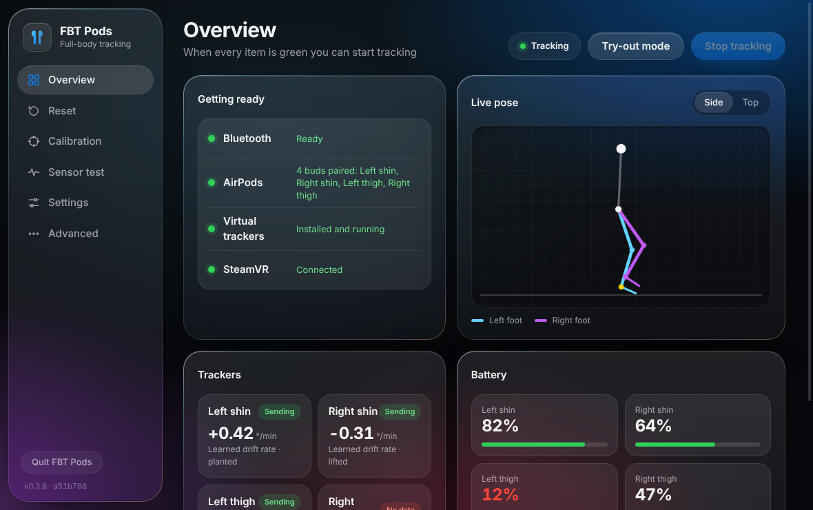
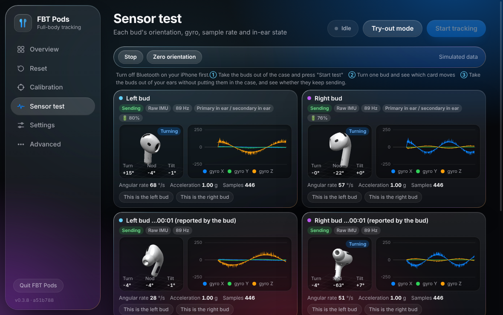
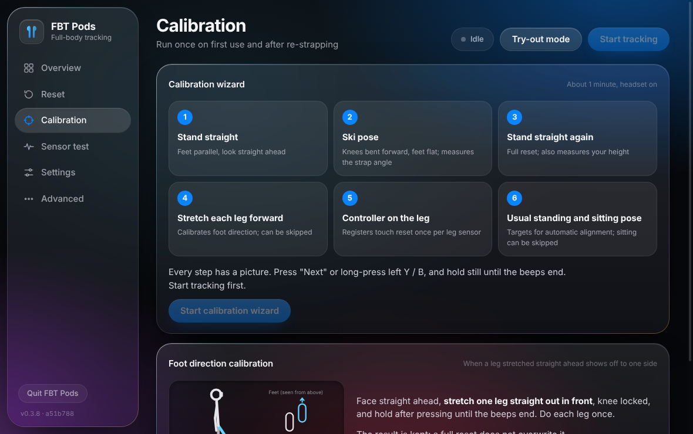

<div align="center">

# FBT Pods

**Full-body tracking for SteamVR with the AirPods you already own.**

Strap AirPods to your legs and they become trackers for VRChat and other SteamVR games.

[](https://github.com/IROHAuwu/fbtpods/actions/workflows/tests.yml)


**English** · [繁體中文](README.zh-TW.md)



</div>

## What it does

- Connects to AirPods over a Bluetooth adapter of their own and reads each bud's motion sensors.
- Solves your hips, knees and feet from the headset and the buds, and sends them to SteamVR as trackers.
- Portable: unzip, double-click `FBTPods.exe`. No Python, no installer.
- Guided setup for Bluetooth, pairing and calibration, with a try-out mode that needs no hardware.
- Interface in English, 繁體中文, 日本語, 한국어 and Español (Settings → Language).

## Read this first

> [!IMPORTANT]
> **One pair of AirPods is one tracker.** A pair only sends motion from one bud (the primary). Every tracker needs its own pair: use one bud from each and leave the other in its case with the lid closed.

> [!WARNING]
> **Turn off Bluetooth on your iPhone, iPad and Mac while you play.** AirPods that are also connected to an Apple device answer the connection but send no motion data.

> [!CAUTION]
> A separate USB Bluetooth adapter is recommended. If you use the PC's built-in Bluetooth instead, Windows Bluetooth is disabled while FBT Pods uses it, so other Bluetooth headphones and controllers cannot connect. One click under Advanced gives it back.

> [!NOTE]
> AirPods have no magnetometer, so their heading drifts slowly. FBT Pods corrects it while you play, and a reset is one button press away. Expect something less precise than dedicated trackers.

## How many AirPods do I need?

| Pairs | Where they go | What you get |
| :---: | --- | --- |
| **2** | Both shins | Waist and knees are estimated |
| **3** | Both shins + waist | Waist is measured: twisting, bending, sitting and lying are more accurate |
| **4** | Both shins + both thighs | Knees are measured: sitting, kneeling and leg raises are more accurate |
| **5+** | Shins + thighs + waist or chest | Can hand the body to a SlimeVR Server (optional) |

### Supported models

| Model | Data | Status |
| --- | --- | --- |
| AirPods 3 | Raw accelerometer + gyro, 100 Hz | Main target, tested on hardware |
| AirPods Pro (1st gen) | Raw accelerometer + gyro | Works (user reports) |
| AirPods Pro 2 | Raw data when available, otherwise fused orientation (the USB-C model A3048 sent nothing on raw services 11 / 12 and fused at about 100 Hz) | Connects and streams (A3048, sensor test together with a Pro 3); full-body tracking not yet tried |
| AirPods Pro 3 | Fused orientation at about 100 Hz (raw services 11 / 12 sent nothing) | Connects and streams (A3064, sensor test with a TP-Link UB500); full-body tracking not yet tried |
| AirPods 4 | Expected to match Pro 2 | Experimental, untested |
| AirPods 2 | No gyroscope | Not usable |

## What you need

- **AirPods**, one pair per tracker (see above).
- **A USB Bluetooth adapter** just for the AirPods (recommended). Realtek-based adapters such as the TP-Link UB500 and Intel AX210 / AX211 / BE200 work out of the box; firmware is bundled and loaded automatically.
- **SteamVR**, a headset and controllers.
- **Straps.** Stem pointing down, tight enough not to wobble: outer shin above the ankle, outer thigh above the knee, waist on the belt at the back or side.
- The virtual tracker driver **VMT** — FBT Pods installs it for you.

<details>
<summary>More Bluetooth chips</summary>

- **Experimental** (written from the Linux drivers and checked in an emulator, waiting for reports from real hardware): Intel AX200 / AX201 / 9260 / 9560 / 8265, MediaTek MT7921 / 7922 / 7925, Qualcomm QCA61x4 / QCA9377 / WCN6855.
- **No firmware needed:** CSR, Broadcom, Actions, Barrot, Atheros AR3012.
- "Set up Bluetooth" shows whether your chip is supported before it changes anything, tests it afterwards, and can undo the change with one click.

</details>

## Quick start

1. Download the latest `FBT_Pods_v….zip` from [Releases](https://github.com/IROHAuwu/fbtpods/releases) and unzip **the whole folder** anywhere.
2. Double-click `FBTPods.exe`.
3. On **Overview**, turn every item green:

   | Item | Button | What happens |
   | --- | --- | --- |
   | Bluetooth | Set up Bluetooth | Choose USB or built-in. For USB: unplug, plug in again, and the adapter is recognised and given the AirPods driver. Windows asks for administrator permission once |
   | AirPods | Pair | Open the case, hold the back button until the light flashes white, search, pair. Then pick where each bud is worn |
   | Virtual trackers | Install | Downloads VMT v0.15 (fixed version, SHA-256 checked) and adds it to SteamVR. Restart SteamVR once afterwards |
   | SteamVR | — | Connects when tracking starts |

4. Put the headset on, press **Start tracking**, and run the **calibration wizard** (it opens by itself after pairing).

> [!TIP]
> No AirPods at hand? Press **Try-out mode**: simulated legs drive the whole system so you can look around first.

### Pairing and choosing sides

After pairing, take one bud of each pair out and lay it on the table. Every bud appears as a live 3D model: pick one up and its model moves with it. Choose where each one goes, then strap them on.

<div align="center">

<br><sub>The sensor test page shows every bud by itself: orientation, gyro, sample rate, in-ear state and battery.</sub>
</div>

## Calibration and resets

The wizard takes about a minute with the headset on. Every step has a picture and a beep countdown, and a **long press on left Y / B** works instead of the mouse.

<div align="center">

</div>

After that, each session only needs: **stand straight and long-press left Y / B**.

| Reset | Default button (Quest controllers) | When |
| --- | --- | --- |
| **Full reset** | Left Y, long press | At the start and after re-strapping. Stand straight, look ahead |
| **Quick reset** | Left Y, double press | Any time, any pose |
| **Touch reset** | Left X / right B, long press | Accurate in any pose: hold that hand's controller on the shin as in the wizard |
| **Pause** | Window button only | While adjusting straps |

- One short buzz means done, two mean it failed.
- The bud stems work too: **double press = quick reset, triple press = full reset, long press = pause**.
- Index controllers use B / A, Vive wands the menu button. Rebind under SteamVR Settings → Controllers → Show Binding UI → FBT Pods.

## Two ways to solve the body

Choose under **Settings → Body solver and output**.

| | FBT Pods (default) | SlimeVR Server (optional) |
| --- | --- | --- |
| Who solves the body | FBT Pods: hips from the headset, legs from the buds | A [SlimeVR Server](https://slimevr.dev) you install yourself |
| Into SteamVR through | VMT | SlimeVR's own driver |
| Buds | **2–4** | **5 or more** (both shins + both thighs + waist or chest) |

> [!WARNING]
> SlimeVR's skeleton needs a waist or chest tracker. With 4 buds or fewer the waist and upper body look wrong there, which is why FBT Pods' own solver is the default: it is built for having no waist tracker.

<details>
<summary><b>Setting up SlimeVR Server (5 or more buds)</b></summary>

FBT Pods presents every paired pair as a SlimeVR tracker over SlimeVR's UDP protocol on this PC (port 6969). Nothing goes over Wi-Fi; a PC without Wi-Fi is fine. The same steps are in the program under Overview → SlimeVR Server → Help.

**First time**

1. Install and open the SlimeVR Server with its SteamVR driver (not included).
2. When its setup asks for the tracker type, choose third-party trackers, then **Wi-Fi** (not the dongle).
3. On the Wi-Fi page press **Skip Wi-Fi settings**, or type anything and press Submit.
4. The next page asks for a tracker over USB: ignore it, close the "No trackers detected" window, press **I connected all my trackers** and continue to the home page.
5. In FBT Pods press **Start tracking**. SteamVR does not have to be open yet.
6. SlimeVR shows **A new tracker was found!** Press **Sure!**, once per bud. Do not press "Ignore it".
7. Under **Tracker Assignment** give each tracker a body part. A tracker's name ends with the last five characters of the bud's Bluetooth address. SlimeVR calls the shins "ankles".
8. Do **Body Proportions** and **Mounting Calibration** once each, then stand straight and press **Full Reset**.

**Every time after that:** open the SlimeVR Server → Start tracking in FBT Pods → stand straight and do a full reset.

- Full reset and quick reset (SlimeVR's Yaw Reset) are passed on from the FBT Pods buttons, the controller buttons and the bud stems.
- The calibration wizard and touch reset are not used in this mode.

</details>

<details>
<summary><b>What FBT Pods' own solver does</b></summary>

- Estimates the hips from the headset: standing, crouching, sitting, bending over, and lying down on your back, front or side.
- Follows the play space when it is moved (OVR Advanced Settings height, drag, rotation).
- Measures and corrects the offset between a streaming headset's driver (Virtual Desktop and others) and VMT.
- Locks orientation while the whole body is still, keeps feet from sinking through the floor, and corrects skating.
- **Leg solver → SlimeVR-style (fallback):** foot lock, joint limits and filtering ported from the SlimeVR Server. Feet may lock too early while walking, so it is not the default.
- **Pose model (optional, two shins only):** [HMD-Poser](https://github.com/Pico-AI-Team/HMD-Poser). Download the weights under Advanced (about 103 MB; trained on AMASS, non-commercial use only).

</details>

## Troubleshooting

| Problem | What to do |
| --- | --- |
| Adapter not detected in "Set up Bluetooth" | Make sure it is a Bluetooth adapter, not Wi-Fi. Try another USB port. Replug within 60 seconds |
| Only one bud of a pair sends data | Normal. Use one bud per pair and keep the other in its closed case |
| With 3–4 pairs a bud freezes or disappears | Set Bud sample rate to Automatic or 50 Hz |
| "Needs pairing again" | The buds no longer know this PC. Run Pair again |
| "Connected but no motion data" | Turn off Bluetooth on your iPhone / iPad / Mac |
| AirPods Pro stop sending a few seconds after being put down or strapped on | Settings → Turn off automatic ear detection while in use (experimental). It is switched back on when tracking stops, and also at the next connection if FBT Pods was closed abruptly |
| AirPods Pro 2 / Pro 3 / AirPods 4: "connected but no motion data" | These buds answer sensor requests only from the device that is actively using them: turn off Bluetooth on your iPhone / iPad / Mac. The log names the model (e.g. `model A3064 (AirPods Pro 3)`) and says whether raw IMU or the ~100 Hz fused stream is used |
| "USB Bluetooth adapter disconnected" | The adapter was unplugged or reset by Windows: plug it back in, then stop and start tracking |
| A sensor no longer appears | Put the bud in its case and take it out again, or restart tracking |
| Feet slowly turn | Quick reset. If far off, or lying down, use touch reset |
| No trackers in SteamVR | Is Virtual trackers green? Restart SteamVR once, and check VMT under SteamVR Settings → Startup / Shutdown → Manage Add-ons |
| Controller buttons do nothing | SteamVR Settings → Controllers → Show Binding UI: check that FBT Pods has its bindings. The window buttons always work |
| I want Bluetooth back in Windows | Advanced → Give Bluetooth back to Windows |

**Reporting a problem:** Advanced → Export diagnostics packs the log, settings, calibration and version into one zip. It contains your AirPods' Bluetooth addresses, but no pairing keys.

## For developers

<details>
<summary>Run from source, build, update VMT</summary>

Double-click `FBTPods.bat`: it installs Python 3.12 when needed, creates the environment and opens the window.

```
FBTPods.bat diag         hardware check (terminal)
FBTPods.bat pair         pairing only (terminal)
FBTPods.bat demo         try-out mode (terminal)
FBTPods.bat run          track without the window
python -m pytest tests   tests, no hardware needed
```

- **Portable build** (any OS): `python packaging/build_portable.py` writes `dist/FBTPods-portable.zip` with a portable Python 3.12, all Windows packages and the `FBTPods.exe` launcher. Package versions are pinned in `packaging/constraints.txt`.
- **GitHub Actions:** every push runs the tests. "Build Windows installer" (Run workflow) produces the portable zip and the installer.
- **Translations:** text is written in Traditional Chinese in the source and looked up in `airpodsvr/web/i18n/<lang>.json`. `python tools/i18n_extract.py --missing en` lists text without a translation; the tests fail when one is missing.
- **Updating VMT:** after testing a new version, change `VMT_TAG`, `VMT_FILE` and `VMT_SHA256` in `airpodsvr/winsetup.py`.

User data (settings, calibration, log) lives in `app\data\` in the portable version and `data\` when run from source.

</details>

## Contributors

- [IROHAuwu](https://github.com/IROHAuwu) — project owner: idea, design decisions, hardware testing.
- [Claude](https://claude.com/claude-code) (Anthropic) — code, tests, documentation and translations, written with IROHAuwu.

## Credits and licence

- Built on [MousePods](https://github.com/starman-tech/mousepods) by Matteo Gaudioso, the first public documentation of how AirPods expose their motion sensors.
- [VMT](https://github.com/gpsnmeajp/VirtualMotionTracker) by gpsnmeajp, [SlimeVR Server](https://github.com/SlimeVR/SlimeVR-Server), [HMD-Poser](https://github.com/Pico-AI-Team/HMD-Poser), [AirPointer](https://github.com/oscarcreatess/airpointer), and the earbud 3D models by Falah3D.
- Code: Apache-2.0. A personal, non-commercial project. Full notices are in [`NOTICE`](NOTICE) and in the program under Advanced → About and licences.

FBT Pods is not affiliated with Apple Inc. or SlimeVR B.V. AirPods is a trademark of Apple Inc.
