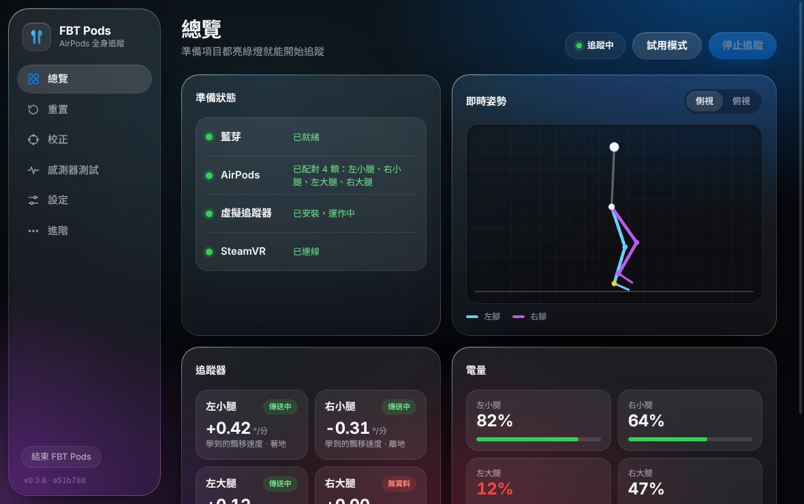
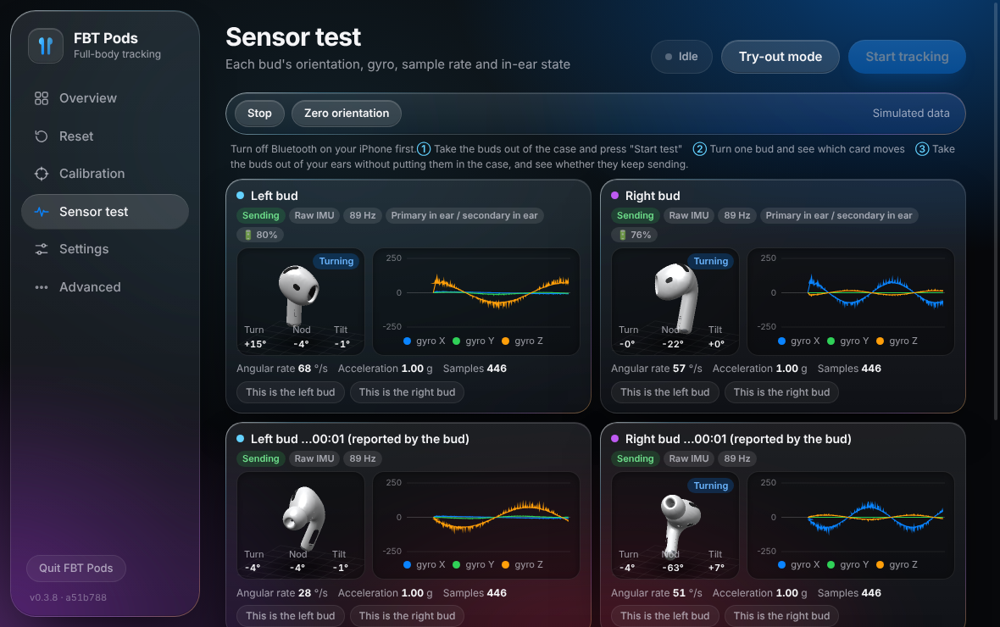
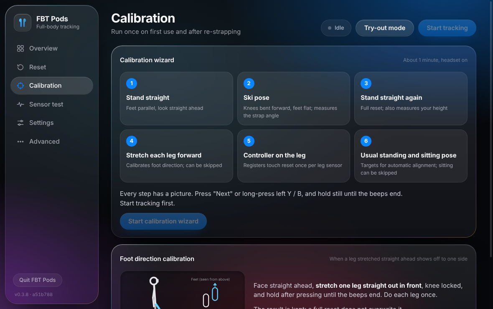

<div align="center">

# FBT Pods

**用你手邊的 AirPods 做 SteamVR 全身追蹤。**

把 AirPods 綁在腿上，它們就是 VRChat 等 SteamVR 遊戲的追蹤器。

[](https://github.com/IROHAuwu/fbtpods/actions/workflows/tests.yml)


[English](README.md) · **繁體中文**



</div>

## 它做什麼

- 用一支專用的藍牙連上 AirPods，讀出每顆耳機的動作感測器。
- 由頭顯和耳機算出髖部、膝蓋和腳，當成追蹤器送進 SteamVR。
- 免安裝：解壓縮後雙擊 `FBTPods.exe`，不需要 Python。
- 藍牙、配對、校正都有引導；沒有耳機也能用「試用模式」先看。
- 介面有 English、繁體中文、日本語、한국어、Español（Settings → Language；第一次開啟是英文）。

## 使用前必讀

> [!IMPORTANT]
> **一副 AirPods 只能當一個追蹤點。** 一副只有主耳會送出動作資料。每個追蹤點需要一副：每副拿一顆，另一顆留在盒內並蓋上盒蓋。

> [!WARNING]
> **使用時請關掉 iPhone／iPad／Mac 的藍牙。** AirPods 同時連著 Apple 裝置時，會回應連線但不傳送動作資料。

> [!CAUTION]
> 建議另外準備一支 USB 藍牙。改用電腦內建藍牙時，使用期間 Windows 的藍牙會停用，其他藍牙耳機和手把無法連線；「進階」裡可以一鍵還原。

> [!NOTE]
> AirPods 沒有磁力計，水平方向會慢慢飄。程式在使用中會自動修正，手動重置也只要按一下。精準度不如專用追蹤器。

## 需要幾副 AirPods？

| 副數 | 綁的位置 | 效果 |
| :---: | --- | --- |
| **2** | 雙小腿 | 腰與膝靠推算 |
| **3** | 雙小腿＋腰 | 腰直接量：扭腰、彎腰、坐、躺更準 |
| **4** | 雙小腿＋雙大腿 | 膝直接量：坐、跪、抬腿更準 |
| **5 以上** | 小腿＋大腿＋腰或胸 | 可以把身體交給 SlimeVR Server（自選） |

### 支援的型號

| 型號 | 資料 | 狀態 |
| --- | --- | --- |
| AirPods 3 | 原始加速度＋陀螺儀，100 Hz | 主要支援，實機驗證 |
| AirPods Pro（第 1 代） | 原始加速度＋陀螺儀 | 可用（依實機回報） |
| AirPods Pro 2 | 有原始資料就用，否則用耳機內建融合姿態（約 25 Hz） | 實驗性 |
| AirPods Pro 3、AirPods 4 | 推測同 Pro 2 | 實驗性，未驗證 |
| AirPods 2 | 沒有陀螺儀 | 不能用 |

## 需要準備

- **AirPods**：每個追蹤點一副（見上）。
- **一支 USB 藍牙**，只給 AirPods 用（建議）。Realtek 晶片（例如 TP-Link UB500）與 Intel AX210／AX211／BE200 可直接使用，韌體已內建並自動載入。
- **SteamVR**、頭顯與手把。
- **綁帶**：柄朝下、貼緊不晃。小腿外側腳踝上方；大腿外側膝蓋上方；腰部皮帶正後方或側邊。
- 虛擬追蹤器驅動 **VMT**：程式會代為安裝。

<details>
<summary>其他藍牙晶片</summary>

- **實驗性**（依 Linux 驅動實作、以模擬器驗證，尚待實機回報）：Intel AX200／AX201／9260／9560／8265、MediaTek MT7921／7922／7925、Qualcomm QCA61x4／QCA9377／WCN6855。
- **不需要韌體**：CSR、Broadcom、Actions、Barrot、Atheros AR3012。
- 「準備藍芽」會先顯示晶片是否支援，安裝後自動測試，失敗可一鍵還原。

</details>

## 開始使用

1. 到 [Releases](https://github.com/IROHAuwu/fbtpods/releases) 下載 `FBT_Pods_v1.zip`，**整個資料夾**解壓到任何位置。
2. 雙擊 `FBTPods.exe`。
3. 在「總覽」頁把每個項目變成綠燈：

   | 項目 | 按鈕 | 會發生什麼事 |
   | --- | --- | --- |
   | 藍芽 | 準備藍芽 | 選 USB 或內建。USB：先拔掉 → 再插上 → 程式認出並換成 AirPods 專用驅動。Windows 會問一次系統管理員權限 |
   | AirPods | 配對 | 打開盒蓋、按住背面按鈕到閃白光 → 搜尋 → 配對，再替每顆選要綁的位置 |
   | 虛擬追蹤器 | 安裝 | 下載 VMT v0.15（固定版本，核對 SHA-256）並加進 SteamVR；之後重開 SteamVR 一次 |
   | SteamVR | — | 開始追蹤時自動連線 |

4. 戴上頭顯，按「開始追蹤」，執行**校正精靈**（配對完成後會自動開啟）。

> [!TIP]
> 手邊沒有 AirPods？按「試用模式」，程式用模擬的腿部動作驅動整套系統。

### 配對與分左右

配對後把每副的一顆拿出來放在桌上。畫面上每顆耳機都有即時 3D 模型：拿起哪一顆，哪個模型就跟著動。替每顆選位置後再綁到身上。

<div align="center">

<br><sub>「感測器測試」頁把每顆耳機分開顯示：方向、陀螺儀、取樣率、入耳狀態與電量。</sub>
</div>

## 校正與重置

校正精靈約 1 分鐘，戴著頭顯做。每一步有姿勢圖和嗶聲倒數，可以**長按左手 Y／B** 代替滑鼠。

<div align="center">

</div>

之後每次只要：**站直、長按左手 Y／B**。

| 重置 | 預設按鍵（Quest 手把） | 何時用 |
| --- | --- | --- |
| **完整重置** | 左手 Y 長按 | 開場與換綁帶後；站直看前方 |
| **快速重置** | 左手 Y 雙擊 | 任何時間、任何姿勢 |
| **貼合重置** | 左手 X／右手 B 長按 | 任何姿勢都準：把該手手把照校正時的方式貼在小腿正面 |
| **暫停** | 只有視窗上的按鈕 | 調整綁帶時 |

- 手把短震一下是成功，震兩下是失敗。
- 也可以按耳機柄：**按兩下＝快速重置、按三下＝完整重置、長按＝暫停**。
- Index 手把用 B／A，Vive 手把用選單鍵。改鍵：SteamVR 設定 → 控制器 → 顯示綁定介面 → FBT Pods。

## 身體的兩種算法

在「設定 → 身體演算與輸出」選擇。

| | FBT Pods（預設） | SlimeVR Server（自選） |
| --- | --- | --- |
| 誰計算身體 | 本程式：由頭顯推算髖部，由耳機解出腿 | 你另外安裝的 [SlimeVR Server](https://slimevr.dev) |
| 怎麼進 SteamVR | VMT | SlimeVR 自己的驅動 |
| 耳機數 | **2～4 顆** | **5 顆以上**（雙小腿＋雙大腿＋腰或胸） |

> [!WARNING]
> SlimeVR 的骨架需要腰或胸的追蹤器。4 顆以下時它的腰和上半身會很不自然，所以預設是 FBT Pods 自己的算法：它專門處理「沒有腰部追蹤器」的情況。

<details>
<summary><b>SlimeVR Server 的設定步驟（5 顆以上）</b></summary>

FBT Pods 把每一副已配對的耳機當成一個 SlimeVR 追蹤器，用 SlimeVR 的 UDP 協定在本機（6969 埠）送出。不經過 Wi-Fi，電腦沒有 Wi-Fi 也可以。程式內「總覽 → SlimeVR Server → 說明」有同樣的步驟。

**第一次設定**

1. 安裝並開啟 SlimeVR Server（含它的 SteamVR 驅動；FBT Pods 不附帶）。
2. 設定精靈問追蹤器類型時，第三方追蹤器選 **「Wi-Fi」**（不是接收器／加密狗）。
3. 「透過 Wi-Fi 連接」那一頁：按 **「跳過 Wi-Fi 設定」**，或隨便填再按「送出！」。
4. 下一頁要你用 USB 接追蹤器：不用理會，關掉「找不到追蹤器」的視窗，按 **「所有的追蹤器都連接好了」**，一路到首頁。
5. 回到 FBT Pods 按「開始追蹤」。不用先開 SteamVR。
6. SlimeVR 跳出 **「找到了新的追蹤器！」**：按 **「好喔！」**，每顆一次。不要按「別管它」。
7. **「追蹤器分配」**：替每顆指定部位。追蹤器名稱結尾＝耳機藍牙位址末五碼。小腿在 SlimeVR 裡叫「腳踝」。
8. **「軀幹比例」** 和 **「配戴校正」** 各做一次，最後站直按 **「完整重置」**。

**之後每次**：開啟 SlimeVR Server → FBT Pods 按「開始追蹤」→ 站直做完整重置。

- 完整重置與快速重置（＝SlimeVR 的「左右偏擺重置」）：FBT Pods 的按鈕、手把按鍵和耳機柄都會轉交給 SlimeVR。
- 校正精靈和貼合重置在這個方式下不會用到。

</details>

<details>
<summary><b>FBT Pods 自己的算法做了哪些事</b></summary>

- 由頭顯推算髖部：站、蹲、坐、彎腰，以及仰躺、趴著、側躺。
- 遊玩空間被移動時（OVR Advanced Settings 調整高度、拖動、旋轉），追蹤器跟著移動。
- 串流頭顯（Virtual Desktop 等）的驅動座標和 VMT 不同時，自動量出差距並修正。
- 整個身體靜止時鎖住方向、防地板穿透、防滑步。
- **腿部演算 → SlimeVR 式（備案）**：從 SlimeVR Server 移植的鎖腳、關節限制與濾波。走路時腳可能提早被鎖住，所以不是預設。
- **姿勢模型（選用，只在雙小腿時）**：[HMD-Poser](https://github.com/Pico-AI-Team/HMD-Poser)。在「進階」下載權重（約 103 MB；以 AMASS 訓練，僅限非商業用途）。

</details>

## 疑難排解

| 狀況 | 處理 |
| --- | --- |
| 準備藍芽時偵測不到 | 確認插的是藍牙（不是 Wi-Fi 網卡）、換一個 USB 孔；拔掉再插上要在 60 秒內 |
| 一副只收到一顆 | 正常。每副拿一顆，另一顆放回盒內蓋上 |
| 三、四副時有耳機停住或消失 | 耳機取樣率用「自動」或「50 Hz」 |
| 顯示「需要重新配對」 | 耳機已不認得這台電腦：按「配對」重做 |
| 顯示「已連線但沒有動作資料」 | 關掉 iPhone／iPad／Mac 的藍牙 |
| AirPods Pro 放下或綁上後過幾秒就停止傳送 | 設定 →「使用期間關閉自動入耳偵測」（試驗功能） |
| 感測器不再出現 | 把耳機放回盒子再拿出；或重新開始追蹤 |
| 腳的方向慢慢偏 | 快速重置；偏很多或躺著時用貼合重置 |
| SteamVR 看不到追蹤器 | 「虛擬追蹤器」是否綠燈；SteamVR 重開一次，並確認 SteamVR 設定 →「啟動／關閉」→「管理附加元件」裡 VMT 是開啟的 |
| 手把按鍵沒有反應 | SteamVR 設定 → 控制器 → 顯示綁定介面，確認 FBT Pods 有載入綁定；視窗上的按鈕不受影響 |
| 想把藍牙還給 Windows | 「進階 → 把藍芽還給 Windows」 |

**回報問題**：「進階 → 匯出診斷包」會把紀錄、設定、校正與版本資訊打包成一個 zip。裡面有 AirPods 的藍牙位址，不含配對金鑰。

## 開發者

<details>
<summary>從原始碼執行、建置、更新 VMT</summary>

雙擊 `FBTPods.bat`：需要時自動安裝 Python 3.12、建立環境並開啟視窗。

```
FBTPods.bat diag         硬體驗證（終端機）
FBTPods.bat pair         只做配對（終端機）
FBTPods.bat demo         試用模式（終端機）
FBTPods.bat run          不開視窗直接追蹤
python -m pytest tests   測試（不需硬體）
```

- **便攜版**（任何作業系統都能建置）：`python packaging/build_portable.py` 產生 `dist/FBTPods-portable.zip`，內含可攜式 Python 3.12、所有 Windows 套件與 `FBTPods.exe` 啟動器。套件版本固定在 `packaging/constraints.txt`。
- **GitHub Actions**：每次 push 跑測試。「Build Windows installer」（Run workflow）產生便攜版與安裝檔。
- **翻譯**：原始碼裡的文字是繁體中文，顯示時查 `airpodsvr/web/i18n/<語言>.json`。`python tools/i18n_extract.py --missing en` 列出還沒翻譯的文字；缺翻譯時測試不會通過。
- **更新 VMT 版本**：測過新版後，改 `airpodsvr/winsetup.py` 的 `VMT_TAG`、`VMT_FILE`、`VMT_SHA256`。

使用者資料（設定、校正、紀錄）：便攜版在 `app\data\`，原始碼版在 `data\`。

</details>

## 貢獻者

- [IROHAuwu](https://github.com/IROHAuwu)：專案擁有者，負責構想、設計決定與實機測試。
- [Claude](https://claude.com/claude-code)（Anthropic）：與 IROHAuwu 一起完成程式、測試、文件與翻譯。

## 致謝與授權

- 基於 Matteo Gaudioso 的 [MousePods](https://github.com/starman-tech/mousepods)：第一份公開說明 AirPods 如何提供動作感測器資料的研究。
- [VMT](https://github.com/gpsnmeajp/VirtualMotionTracker)（gpsnmeajp）、[SlimeVR Server](https://github.com/SlimeVR/SlimeVR-Server)、[HMD-Poser](https://github.com/Pico-AI-Team/HMD-Poser)、[AirPointer](https://github.com/oscarcreatess/airpointer)，以及 Falah3D 的耳機 3D 模型。
- 程式碼：Apache-2.0。個人、非商業專案。完整聲明見 [`NOTICE`](NOTICE)，程式內「進階 → 關於與授權」也看得到。

FBT Pods 與 Apple Inc.、SlimeVR B.V. 無關。AirPods 是 Apple Inc. 的商標。
